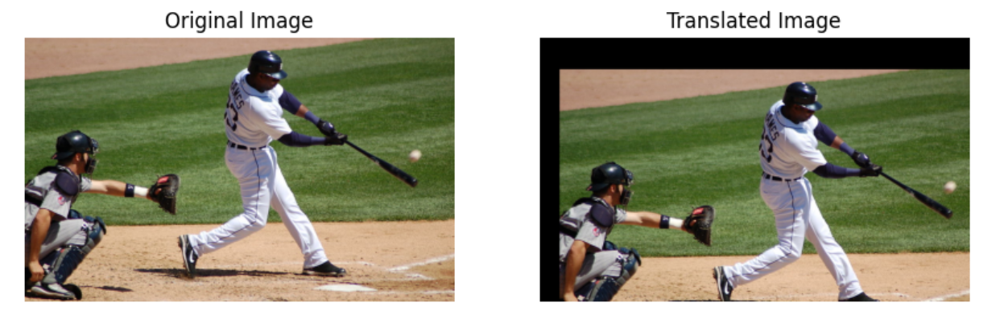
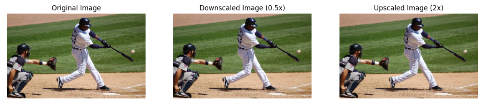
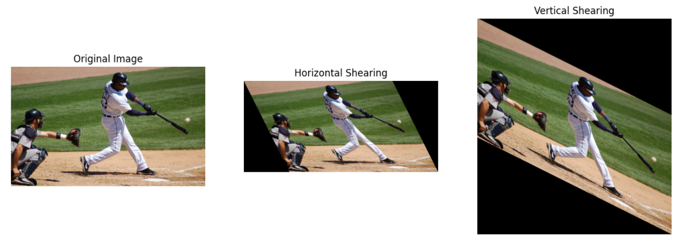
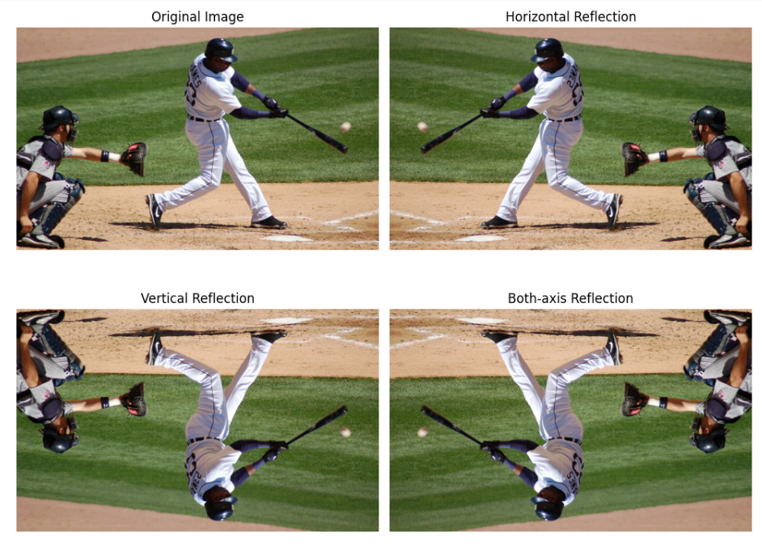
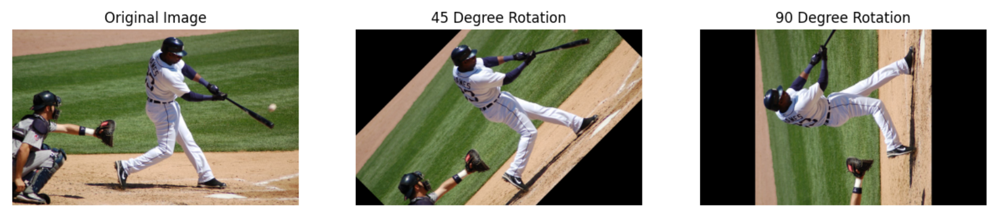

# Geometric Transformations Using OpenCV


## Aim

To write a Python program using OpenCV to perform various geometric transformations on an image.

The program performs the following operations:

- Image Translation  
- Image Scaling (Resizing)  
- Image Shearing  
- Image Reflection (Flipping)  
- Image Rotation  


##  Software Used

- Anaconda – Python 3.7  
- Jupyter Notebook / VS Code  
- OpenCV (`cv2`)  
- NumPy  
- Matplotlib  


##  Algorithm

### Step 1:
Import the required libraries: OpenCV, NumPy, and Matplotlib.

### Step 2:
Read the input image in color mode.

### Step 3: Image Translation
- Create a translation matrix to shift the image  
- Move the image 50 pixels to the right and 80 pixels down  
- Apply transformation using `cv2.warpAffine()`  
- Display original and translated images  

### Step 4: Image Scaling
- Resize the image to 0.5× (downscale)  
- Resize the image to 2× (upscale)  
- Use `cv2.resize()`  
- Display original, downscaled, and upscaled images  

### Step 5: Image Shearing
- Create transformation matrices for:
  - Horizontal shearing  
  - Vertical shearing  
- Apply transformations using `cv2.warpAffine()`  
- Display original and sheared images  

### Step 6: Image Reflection
- Perform flipping using `cv2.flip()`:
  - Horizontal reflection  
  - Vertical reflection  
  - Both axes  
- Display all reflected images  

### Step 7: Image Rotation
- Create rotation matrices for:
  - 45° rotation  
  - 90° rotation  
- Use `cv2.getRotationMatrix2D()` and `cv2.warpAffine()`  
- Display original and rotated images  


##  Program

### Developed By: NARENDHIRAN P

### Register No: 212224230177

```py

# Import required libraries
import cv2
import numpy as np
import matplotlib.pyplot as plt

# Read the input image
img = cv2.imread('/content/input.jpg')

if img is None:
    raise FileNotFoundError("Image not found. Upload input.jpg")

# Convert BGR to RGB
img = cv2.cvtColor(img, cv2.COLOR_BGR2RGB)

# Get image dimensions
h, w = img.shape[:2]


# =====================================
# 1. IMAGE TRANSLATION
# =====================================

M = np.float32([
    [1, 0, 50],
    [0, 1, 80]
])

translated = cv2.warpAffine(img, M, (w, h))

plt.figure(figsize=(10, 5))

plt.subplot(1, 2, 1)
plt.imshow(img)
plt.title("Original Image")
plt.axis("off")

plt.subplot(1, 2, 2)
plt.imshow(translated)
plt.title("Translated Image")
plt.axis("off")

plt.show()


# =====================================
# 2. IMAGE SCALING
# =====================================

downscaled = cv2.resize(img, None, fx=0.5, fy=0.5)
upscaled = cv2.resize(img, None, fx=2, fy=2)

plt.figure(figsize=(15, 5))

plt.subplot(1, 3, 1)
plt.imshow(img)
plt.title("Original Image")
plt.axis("off")

plt.subplot(1, 3, 2)
plt.imshow(downscaled)
plt.title("Downscaled Image (0.5x)")
plt.axis("off")

plt.subplot(1, 3, 3)
plt.imshow(upscaled)
plt.title("Upscaled Image (2x)")
plt.axis("off")

plt.show()


# =====================================
# 3. IMAGE SHEARING
# =====================================

# Horizontal shearing
M1 = np.float32([
    [1, 0.5, 0],
    [0, 1, 0]
])

horizontal_shear = cv2.warpAffine(
    img, M1, (w + int(0.5*h), h)
)

# Vertical shearing
M2 = np.float32([
    [1, 0, 0],
    [0.5, 1, 0]
])

vertical_shear = cv2.warpAffine(
    img, M2, (w, h + int(0.5*w))
)

plt.figure(figsize=(15, 5))

plt.subplot(1, 3, 1)
plt.imshow(img)
plt.title("Original Image")
plt.axis("off")

plt.subplot(1, 3, 2)
plt.imshow(horizontal_shear)
plt.title("Horizontal Shearing")
plt.axis("off")

plt.subplot(1, 3, 3)
plt.imshow(vertical_shear)
plt.title("Vertical Shearing")
plt.axis("off")

plt.show()


# =====================================
# 4. IMAGE REFLECTION
# =====================================

horizontal_flip = cv2.flip(img, 1)
vertical_flip = cv2.flip(img, 0)
both_flip = cv2.flip(img, -1)

plt.figure(figsize=(10, 8))

plt.subplot(2, 2, 1)
plt.imshow(img)
plt.title("Original Image")
plt.axis("off")

plt.subplot(2, 2, 2)
plt.imshow(horizontal_flip)
plt.title("Horizontal Reflection")
plt.axis("off")

plt.subplot(2, 2, 3)
plt.imshow(vertical_flip)
plt.title("Vertical Reflection")
plt.axis("off")

plt.subplot(2, 2, 4)
plt.imshow(both_flip)
plt.title("Both-axis Reflection")
plt.axis("off")

plt.tight_layout()
plt.show()


# =====================================
# 5. IMAGE ROTATION
# =====================================

# Rotate by 45 degrees
M1 = cv2.getRotationMatrix2D(
    (w//2, h//2), 45, 1
)

rotated_45 = cv2.warpAffine(img, M1, (w, h))

# Rotate by 90 degrees
M2 = cv2.getRotationMatrix2D(
    (w//2, h//2), 90, 1
)

rotated_90 = cv2.warpAffine(img, M2, (w, h))

plt.figure(figsize=(15, 5))

plt.subplot(1, 3, 1)
plt.imshow(img)
plt.title("Original Image")
plt.axis("off")

plt.subplot(1, 3, 2)
plt.imshow(rotated_45)
plt.title("45 Degree Rotation")
plt.axis("off")

plt.subplot(1, 3, 3)
plt.imshow(rotated_90)
plt.title("90 Degree Rotation")
plt.axis("off")

plt.show()

print("All Geometric Transformations Completed Successfully!")

```


##  Output

### Image Translation
- Original image is displayed  
- Translated image (shifted right and down) is displayed  



### Image Scaling
- Original image is displayed  
- Downscaled image (0.5×) is displayed  
- Upscaled image (2×) is displayed



### Image Shearing
- Original image is displayed  
- Horizontally sheared image is displayed  
- Vertically sheared image is displayed  



### Image Reflection
- Original image is displayed  
- Horizontally flipped image is displayed  
- Vertically flipped image is displayed  
- Both-axis flipped image is displayed  



### Image Rotation
- Original image is displayed  
- 45° rotated image is displayed  
- 90° rotated image is displayed  



##  Result

Thus, various geometric transformations such as translation, scaling, shearing, reflection, and rotation are successfully performed using OpenCV. These transformations demonstrate how images can be spatially manipulated for different computer vision applications.
